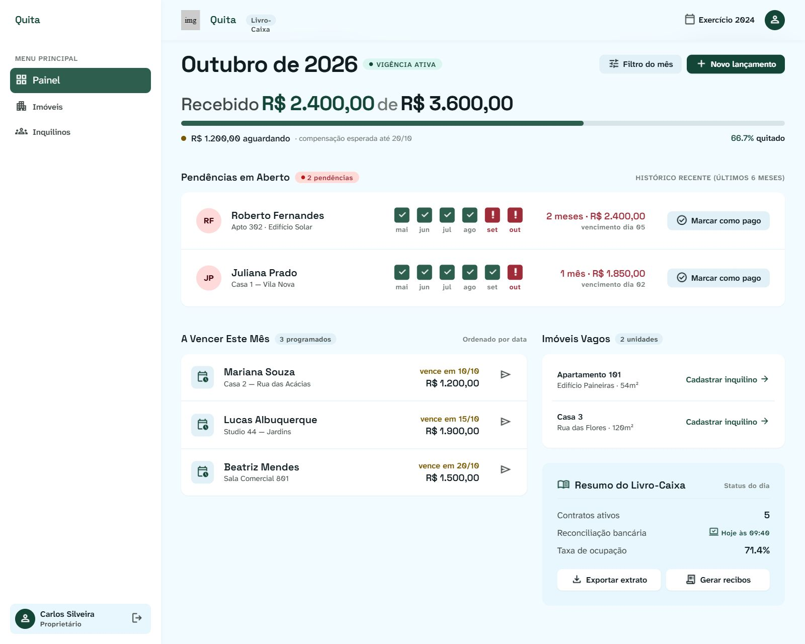
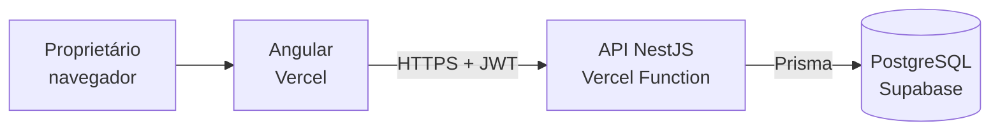

# Quita

Aplicação web para proprietários de imóveis de aluguel controlarem seus inquilinos e os
pagamentos de cada mês, substituindo a agenda, o caderno e a planilha do Excel.

O proprietário cria uma conta, cadastra seus imóveis e inquilinos, e o sistema mostra, mês
a mês, quem já pagou, quem está aguardando e quem está atrasado. Os meses de cobrança são
criados sozinhos: o proprietário não precisa lembrar de lançar nada.

> **Status:** v1 concluída e em fase de publicação na Vercel.

<p align="center">
  
</p>
<p align="center"><sub>Design de referência do painel, modelado no Stitch (<code>docs/Designs/</code>).</sub></p>

---

## Sumário
- [O problema](#o-problema)
- [Funcionalidades](#funcionalidades)
- [Stack](#stack)
- [Arquitetura](#arquitetura)
- [Decisões técnicas em destaque](#decisões-técnicas-em-destaque)
- [Como o projeto foi desenvolvido](#como-o-projeto-foi-desenvolvido)
- [Rodando localmente](#rodando-localmente)
- [Testes](#testes)
- [Deploy](#deploy)
- [Documentação](#documentação)
- [Próximos passos](#próximos-passos)

## O problema

Quem tem vários imóveis alugados costuma controlar tudo em anotações e planilhas. Isso é
fácil de esquecer, difícil de consultar e não mostra com clareza quem está devendo e desde
quando. O Quita responde a três perguntas assim que o proprietário abre o sistema:

- quais imóveis eu tenho e quem mora em cada um?
- quem já pagou este mês, quem está aguardando e quem está atrasado?
- qual é o histórico de pagamentos de cada inquilino?

## Funcionalidades

**Conta e acesso**
- Cadastro e login com e-mail e senha (sessão de 7 dias).
- Cada proprietário vê **somente os próprios dados**. Inquilinos não têm acesso ao sistema.

**Imóveis**
- Cadastro, edição e listagem, com o inquilino atual ou o selo **Vago**.
- Um imóvel tem no máximo um inquilino ativo por vez.
- Exclusão permitida apenas para imóveis que nunca tiveram inquilino (protege o histórico).

**Inquilinos**
- Cadastro com valor do aluguel, dia de vencimento, data de entrada e contato.
- **Início da cobrança** escolhido no cadastro: no mês seguinte à entrada (padrão) ou já no
  mês da entrada, com prévia do primeiro vencimento no formulário.
- Registro de saída: o imóvel fica vago e o histórico, inclusive meses em aberto, é mantido.
- Exclusão apenas de cadastros sem nenhum mês pago (para corrigir enganos).

**Pagamentos**
- **Geração automática dos meses** até o mês atual, inclusive retroativos para inquilinos
  cadastrados com data de entrada no passado.
- Marcar um mês como pago (com a data do pagamento) e desfazer.
- Situação calculada: **Pago**, **Aguardando** ou **Atrasado**, sempre com cor e texto.
- Vencimentos em dias que não existem no mês (29, 30, 31) caem no último dia do mês.

**Painel**
- Recebido do mês em relação ao esperado, com barra de progresso.
- Inquilinos com meses atrasados, quantidade de meses e valor devido.
- Pagamentos a vencer no mês e imóveis vagos.
- Marcar como pago direto do painel.

**Interface**
- **Régua de meses:** componente visual que mostra cada mês como um quadrado (pago,
  aguardando, atrasado), presente no painel e no detalhe do inquilino.
- Responsiva: no celular, o menu vira gaveta e as tabelas viram cartões.
- Valores em reais e datas no formato brasileiro.

## Stack

| Camada | Tecnologias |
|---|---|
| Frontend | Angular 21 (standalone components, signals), Angular Material 21, SCSS |
| Backend | NestJS, Passport + JWT, class-validator, @nestjs/throttler, bcrypt |
| Banco de dados | PostgreSQL no Supabase, Prisma 7 com `@prisma/adapter-pg` |
| Testes | Vitest (unitários e e2e) |
| Deploy | Vercel (frontend e API como projetos separados do mesmo repositório) |
| Design | Google Stitch (telas de referência em `docs/Designs/`) |

## Arquitetura



Monorepo com o backend e o frontend em pastas separadas:

```
quita/
├── backend/                 # API NestJS
│   ├── prisma/              # schema e migrations
│   ├── src/
│   │   ├── auth/            # cadastro, login, guard JWT, @UsuarioAtual()
│   │   ├── imoveis/
│   │   ├── inquilinos/
│   │   ├── pagamentos/      # geração mensal e situação calculada
│   │   ├── painel/
│   │   ├── comum/           # datas no fuso, validadores, pipes
│   │   └── prisma/
│   └── test/                # testes e2e (auth, isolamento, regras)
├── frontend/                # Angular
│   └── src/app/
│       ├── core/            # API, autenticação, modelos, datas e valores
│       ├── compartilhado/   # régua de meses, selo de situação, diálogos, logo
│       ├── layout/
│       └── paginas/         # acesso, painel, imóveis, inquilinos
└── docs/                    # escopo, regras, requisitos, decisões, designs
```

**Modelo de dados:** `Proprietario` → `Imovel` → `Inquilino` → `Pagamento` (um registro por
inquilino e mês). Detalhes em [`docs/modelo-de-dados.md`](docs/modelo-de-dados.md).

## Decisões técnicas em destaque

Todas registradas, com motivo e alternativas descartadas, em
[`docs/decisoes.md`](docs/decisoes.md).

- **Isolamento por proprietário.** O id do proprietário vem sempre do token JWT, nunca da
  requisição, e toda consulta filtra por ele. Registro de outra conta responde `404`
  (e não `403`), para não revelar que o id existe. Coberto por testes e2e específicos.
- **Geração mensal sem tarefa agendada.** Os meses que faltam são criados quando o
  proprietário acessa o sistema. A operação é idempotente (índice único por inquilino e
  mês) e funciona bem no modelo serverless da Vercel, sem cron.
- **"Atrasado" é calculado, não salvo.** O banco guarda só `AGUARDANDO` ou `PAGO`; o atraso
  é derivado da data de vencimento, então nunca fica desatualizado.
- **Dinheiro sem ponto flutuante.** Valores em `Decimal(10,2)` no banco, trafegando como
  string na API (`"1200.00"`); no frontend, a conversão é feita por centavos.
- **Datas no fuso do negócio.** "Hoje" é calculado em `America/Cuiaba`, e não no relógio do
  servidor (UTC), para que um pagamento às 23h não caia no dia seguinte.
- **Segurança no Supabase.** RLS habilitado em todas as tabelas, sem políticas, fechando a
  Data API pública do Supabase; o backend acessa apenas pelo Prisma.
- **Limite de tentativas** nas rotas de autenticação (5 por minuto por IP).
- **Migrations aplicadas no deploy.** O build da API na Vercel roda `prisma migrate deploy`,
  então o banco de produção acompanha o código sem comandos manuais.

## Como o projeto foi desenvolvido

O Quita foi desenvolvido **com auxílio de inteligência artificial** (Claude e Claude Code).

A concepção do sistema é minha: a ideia, o escopo, os requisitos, as regras de negócio, a
arquitetura, a stack e os padrões do código foram definidos e decididos por mim, para que a
aplicação fosse coesa do banco de dados à interface. A IA atuou como apoio para discutir
alternativas e, principalmente, para escrever o código a partir dessa especificação.

O processo seguiu estas etapas:

1. **Especificação antes do código:** escopo com objetivos e não-objetivos, regras de negócio
   numeradas (RN-01 a RN-26), requisitos com critérios de aceite e modelo de dados.
2. **Registro de decisões:** cada escolha relevante (stack, banco, deploy, autenticação,
   regras de cobrança, segurança) documentada com o motivo e as alternativas descartadas.
3. **Design próprio:** identidade visual e telas modeladas no Stitch, usadas como fonte da
   verdade visual na construção do frontend.
4. **Construção guiada pela especificação:** o código foi gerado em etapas, seguindo os
   documentos e regras definidos para o projeto.
5. **Testes como critério de pronto:** nenhuma etapa era considerada concluída sem testes
   passando, com atenção especial aos testes de isolamento entre contas.
6. **Revisão e evolução:** ajustes durante o uso, como a habilitação do RLS após o alerta do
   Security Advisor do Supabase e a regra de início da cobrança.

A trilha completa dessas decisões, inclusive as mudanças de rumo, está em
[`docs/decisoes.md`](docs/decisoes.md).

## Rodando localmente

**Pré-requisitos:** Node.js 24, npm e um projeto no [Supabase](https://supabase.com)
(o plano gratuito é suficiente para desenvolvimento).

### 1. Backend

```bash
cd backend
npm install                 # também gera o client do Prisma
cp .env.example .env        # preencha as variáveis (veja abaixo)
npx prisma migrate dev      # cria as tabelas no banco de desenvolvimento
npm run start:dev           # API em http://localhost:3000
```

| Variável | Descrição |
|---|---|
| `DATABASE_URL` | String do *Transaction pooler* do Supabase (porta 6543, com `?pgbouncer=true`) |
| `DIRECT_URL` | String do *Session pooler* ou conexão direta (porta 5432), usada pelas migrations |
| `JWT_SECRET` | Segredo para assinar os tokens (`openssl rand -hex 32`) |
| `FRONTEND_URL` | Origem liberada no CORS (`http://localhost:4200`) |
| `APP_TIMEZONE` | Fuso usado nas regras de data (`America/Cuiaba`) |

### 2. Frontend

```bash
cd frontend
npm install
npm start                   # http://localhost:4200
```

A URL da API fica em `frontend/src/environments/environment.ts`.

## Testes

```bash
cd backend
npm test                    # unitários: datas, geração mensal, situação, serviços
npm run test:e2e            # e2e: autenticação, isolamento entre contas e regras de negócio

cd ../frontend
npm test                    # unitários: datas e conversão de valores
```

Os testes e2e usam o banco de desenvolvimento: cada teste cria contas com e-mails
aleatórios e remove o que criou. Os principais cenários cobertos:

- uma conta tentando ler, editar ou excluir imóveis, inquilinos e pagamentos de outra
  (todas as tentativas devem responder `404`);
- geração dos meses sem duplicar em acessos repetidos;
- um único inquilino ativo por imóvel, pagar e desfazer, saída e exclusão com histórico;
- datas-limite: dia 31, fevereiro, ano bissexto, virada de ano e fuso horário.

## Deploy

Frontend e API são publicados na Vercel como dois projetos ligados a este repositório
(*Root Directory* `frontend` e `backend`). O build da API executa
`prisma migrate deploy && nest build`, e o banco de produção é um projeto separado no
Supabase. As variáveis de ambiente de produção ficam apenas no painel da Vercel.

## Documentação

| Documento | Conteúdo |
|---|---|
| [`docs/escopo.md`](docs/escopo.md) | Problema, objetivos, o que está dentro e fora da v1 |
| [`docs/regras-de-negocio.md`](docs/regras-de-negocio.md) | Regras numeradas (RN-01 a RN-26) |
| [`docs/requisitos.md`](docs/requisitos.md) | Requisitos funcionais e não funcionais, critérios de aceite |
| [`docs/modelo-de-dados.md`](docs/modelo-de-dados.md) | Entidades e relacionamentos |
| [`docs/arquitetura.md`](docs/arquitetura.md) | Estrutura, rotas da API e ambientes |
| [`docs/decisoes.md`](docs/decisoes.md) | Registro de decisões técnicas e de produto |
| [`docs/Designs/`](docs/Designs/) | Telas de referência e mapa de tokens visuais |

## Próximos passos

- Recuperação de senha e confirmação de e-mail.
- Avisos de vencimento e atraso por e-mail para o proprietário.
- Recibo em PDF e anexo de comprovante de pagamento.
- Contrato com vigência e reajuste anual (IGP-M/IPCA).
- Despesas por imóvel e relatórios anuais.

---

Desenvolvido por [@GuillerWeb](https://github.com/GuillerWeb).
