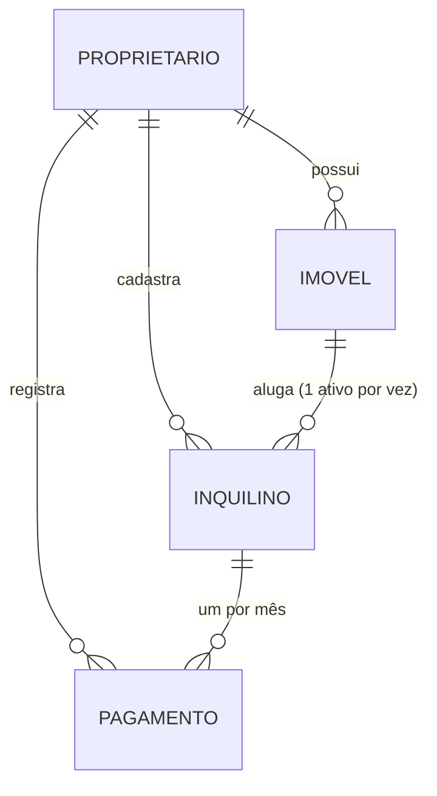

# Modelo de dados — v1

Quatro entidades. Todas as tabelas de negócio carregam `proprietarioId`, para que qualquer
consulta filtre pelo dono direto, sem joins (ver regra 2 do `CLAUDE.md`).



## Schema Prisma (ponto de partida)

```prisma
generator client {
  provider = "prisma-client-js"
}

datasource db {
  provider  = "postgresql"
  url       = env("DATABASE_URL")   // pooler do Supabase (porta 6543, ?pgbouncer=true)
  directUrl = env("DIRECT_URL")     // conexão direta (porta 5432), usada pelas migrations
}

enum StatusPagamento {
  AGUARDANDO
  PAGO
}

model Proprietario {
  id         String      @id @default(uuid())
  nome       String
  email      String      @unique
  senhaHash  String
  criadoEm   DateTime    @default(now())
  imoveis    Imovel[]
  inquilinos Inquilino[]
  pagamentos Pagamento[]
}

model Imovel {
  id             String       @id @default(uuid())
  proprietarioId String
  proprietario   Proprietario @relation(fields: [proprietarioId], references: [id], onDelete: Cascade)
  nome           String
  endereco       String?
  criadoEm       DateTime     @default(now())
  inquilinos     Inquilino[]

  @@index([proprietarioId])
}

model Inquilino {
  id             String       @id @default(uuid())
  proprietarioId String
  proprietario   Proprietario @relation(fields: [proprietarioId], references: [id], onDelete: Cascade)
  imovelId       String
  imovel         Imovel       @relation(fields: [imovelId], references: [id], onDelete: Restrict)
  nome           String
  telefone       String?
  email          String?
  cpf            String?
  observacoes    String?
  valorAluguel   Decimal      @db.Decimal(10, 2)
  diaVencimento  Int          // 1 a 31 (RN-20)
  dataEntrada    DateTime     @db.Date
  dataSaida      DateTime?    @db.Date   // null = ativo
  criadoEm       DateTime     @default(now())
  pagamentos     Pagamento[]

  @@index([proprietarioId])
  @@index([imovelId])
}

model Pagamento {
  id             String          @id @default(uuid())
  proprietarioId String
  proprietario   Proprietario    @relation(fields: [proprietarioId], references: [id], onDelete: Cascade)
  inquilinoId    String
  inquilino      Inquilino       @relation(fields: [inquilinoId], references: [id], onDelete: Cascade)
  competencia    DateTime        @db.Date   // sempre o dia 1 do mês de referência
  valor          Decimal         @db.Decimal(10, 2)
  dataVencimento DateTime        @db.Date
  status         StatusPagamento @default(AGUARDANDO)
  dataPagamento  DateTime?       @db.Date
  criadoEm       DateTime        @default(now())
  atualizadoEm   DateTime        @updatedAt

  @@unique([inquilinoId, competencia])   // garante RN-17 (sem duplicatas)
  @@index([proprietarioId, status, dataVencimento])
}
```

## Restrições que o Prisma não expressa

Adicionar manualmente na migration (SQL) para reforçar a RN-06 no banco:

```sql
-- no máximo um inquilino ativo por imóvel
CREATE UNIQUE INDEX "inquilino_um_ativo_por_imovel"
  ON "Inquilino" ("imovelId") WHERE "dataSaida" IS NULL;
```

O service também valida antes de inserir, para devolver uma mensagem amigável (409) em vez
de um erro de banco.

## Notas
- `competencia` guarda o dia 1 do mês (ex.: `2026-10-01`) e serve de chave do mês.
- `valor` e `dataVencimento` são copiados do inquilino no momento da geração (RN-12).
- "Atrasado" não é coluna (RN-16): calcula-se com
  `status = AGUARDANDO AND dataVencimento < hoje`.
- `onDelete: Restrict` em `Inquilino.imovel` impede apagar imóvel com histórico (RN-08).
